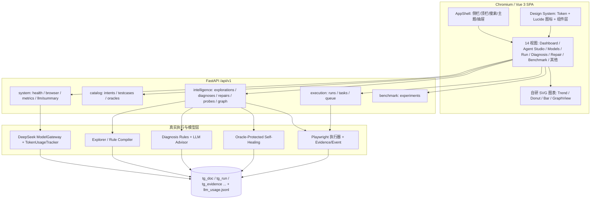

# RUN-004-FE 实施报告

- 日期：2026-11-23
- 分支：`workbuddy/traceguard-autonomous`（未切换、未推送、未强推、未重写历史）
- 基线：RUN-003 / RUN-003-G，222 项后端测试通过
- 范围：前端产品化升级 + 一个只读模型运行统计接口；未改变业务判定与安全边界

## 1. 交付摘要

| 目标 | 结果 |
| --- | --- |
| 统一设计系统 | 完成：token、图标、状态语义、组件层、AppShell |
| 全局布局升级 | 完成：可折叠侧栏、面包屑、搜索、健康/模型状态、主题切换、移动抽屉 |
| 主要页面产品化 | 完成：Dashboard、Agent Studio、Model Operations、Run 详情、Diagnosis、Repair、Benchmark 及其余 7 页 |
| Explorer 真实 LLM 信息 | 完成：删除全部“规则实现/不是 LLM”硬编码，按 engine / llm_stats 动态展示并区分三类决策来源 |
| 模型运行监控 | 完成：新增 `/models` + `GET /api/v1/system/llm/summary` |
| Diagnosis / Evidence Graph | 完成：推理链路、LLM 候选标识、顾问状态、图筛选/缩放/平移/定位 |
| Repair 生命周期 | 完成：7 阶段可视化、代码审查式 Diff、危险操作二次确认 |
| 移动端 | 完成：六档断点无横向溢出，390px 抽屉导航可操作 |
| 全量测试 | 224 passed（222 原有 + 2 新增），ruff 全绿，typecheck/build 通过 |
| 真实浏览器截图 | 15 张 PNG + 机读结果，53/53 检查通过，控制台 0 报错 |

## 2. 新版架构图

关键变化：只读的 `llm/summary` 把 `llm_usage.jsonl` 的聚合能力与 `tg_doc` 中的决策来源数据带给前端；前端不再靠硬编码文案解释模型状态。

## 3. 页面改造说明

| 页面 | 主要变化 |
| --- | --- |
| 全局 | 侧栏分组与 Lucide 图标、折叠、待办计数、底部 DB/Worker/模型状态；顶栏面包屑、Workspace/环境、后端健康、模型状态、⌘K 搜索、主题切换、移动端抽屉 |
| Dashboard | 5 指标卡、近 7 个 UTC 自然日**真实时间分桶**趋势（保留空桶与 n）、四态环图、失败类型、队列/Worker、待办与错误事件；图表/指标可下钻；口径与最后更新时间可见 |
| Agent Studio | 三栏布局（任务/轨迹/步骤+编译）；页头显示 engine、model、prompt、llm_calls、fallback_calls、last_error、耗时；动作按 LLM 决策 / 规则决策 / 规则兜底分类；Gateway 审计计数与内容一致；全部需求可选；已编译可重新编译；Compiler 明确为规则编译器 |
| Model Operations（新增） | provider / 默认与推理模型 / 配置与连通区分、今日调用/错误/Token/估算成本/预算、每日趋势、按 Agent/模型/Flash-Pro 分布、决策来源、延迟与重试、最近调用（安全元数据） |
| Run 详情 | PageHeader + 状态摘要、执行上下文、断言/步骤/证据指标、Oracle 可用性、失败步骤证据定位、断言跳证据、截图放大、证据图控制、诊断联动 |
| Diagnosis 详情 | 症状→假设→证据→规则验证→根因→处置链路；LLM 候选标记 CANDIDATE 与来源；LLM 顾问 called/skipped/added 可见；GraphView 支持类型筛选、缩放、平移、节点定位 |
| Repair 中心 | 7 阶段生命周期、代码审查式 Diff、修改理由、断言/Oracle 完整性、沙箱结果、审批/晋升/回滚记录；危险操作二次确认，权限仍以后端为准 |
| Benchmark | 多组对比图、指标差异矩阵、逐项 n/分母/Wilson CI、样本不足/BLOCKED 明确标识，不用 n=3 宣称显著 |
| P2 页面 | Intents / TestCases / 用例详情 / Oracles / Runs / Diagnoses / System 统一 PageHeader、MetricCard、状态徽标、筛选与空态；修复 Intents 本地假状态与用例执行历史 `startsWith` 误匹配；Oracle 页补充契约解释 |

## 4. API 与数据变更

新增只读端点：`GET /api/v1/system/llm/summary`。

- 数据来源：`TokenUsageTracker.summary()`（`.traceguard/llm_usage.jsonl`）与 `tg_doc` 中 exploration/diagnosis 文档。
- 返回字段：`configured`、`connected`（固定 `unknown`，不主动触网）、`provider`、`default_model`、`reasoning_model`、`calls`、`errors`、`input_tokens`、`output_tokens`、`estimated_cost_usd`、`cost_is_estimated`、`budget_usd`、`budget_exceeded`、`by_agent`、`by_model`、`daily_series`、`latency_summary`、`prompt_versions`、`recent_calls`、`decisions`、`generated_at`、`note`。
- 安全：不含 API Key、完整 Prompt、页面内容、task_id / run_id 明细或原始凭证；成本标注“应用侧估算，非平台账单”；配置态不等于连通态。
- 未修改任何现有业务判定、数据库结构或既有 API 契约。

## 5. 新增依赖及原因

| 依赖 | 版本 | 原因 |
| --- | --- | --- |
| `@lucide/vue` | `^1.77.0` | 官方 Vue 3 图标包，替代 Unicode 字符作为主要功能图标；树摇后按需打包。曾尝试 `lucide-vue-next@1.0.0`，该包已标记 deprecated，故改用官方包 |
| 其他 | — | 未引入 shadcn-vue / Naive UI / PrimeVue / ECharts / Vue Flow，理由见 `docs/RUN-004-FE-DESIGN-DECISIONS.md` |

## 6. 修改文件清单

**修改（26）**：`apps/api/traceguard_api/routers/system.py`、`packages/agents/traceguard_agents/gateway/llm_gateway.py`、`apps/web/package.json`、`apps/web/package-lock.json`、`apps/web/src/{App.vue,api.ts,router.ts,style.css,types.ts}`、`apps/web/src/components/{AsyncBlock.vue,GraphView.vue,MetricCard.vue,StatusBadge.vue}`、`apps/web/src/views/{BenchmarkView.vue,DashboardView.vue,DiagnosesView.vue,DiagnosisDetailView.vue,ExplorerView.vue,IntentsView.vue,OraclesView.vue,RepairsView.vue,RunDetailView.vue,RunsView.vue,SystemView.vue,TestCaseDetailView.vue,TestCasesView.vue}`。

**新增（9 源码/文档 + 截图）**：`apps/web/src/components/{BarChart.vue,CodeDiff.vue,ConfirmDialog.vue,DetailDrawer.vue,DonutChart.vue,PageHeader.vue,TrendChart.vue}`、`apps/web/src/views/ModelsView.vue`、`tests/integration/test_llm_summary.py`、`docs/RUN-004-FE-DESIGN-DECISIONS.md`、`docs/assets/run004-fe/*`。

## 7. 测试结果

| 检查 | 结果 |
| --- | --- |
| `npm run typecheck` | 通过 |
| `npm run build` | 通过（CSS 30.2 kB / gzip 6.75 kB；主 JS 131.9 kB / gzip 49.6 kB） |
| `pytest -q`（全量） | **224 passed**，3 warnings（均为既有 collection/deprecation 提示） |
| `ruff check .` | All checks passed |
| 真实 Chromium + Playwright | **53/53 passed**，console errors = 0 |
| 六档断点（1440/1280/1024/768/390/360） | 无横向溢出；移动端菜单可见 |
| 深色主题 | 12 条路由均无浅色面板残留，文字颜色正确 |

新发现并修复的两个浏览器层问题：环图中心文字拦截扇区点击（`pointer-events: none`）；1024px 下 Benchmark 实验列表表格撑破网格（`.bench-grid > * { min-width: 0 }`）。

## 8. 截图验收

见 `docs/RUN-004-FE-UI-ACCEPTANCE.md` 与 `docs/assets/run004-fe/`。已逐张目检 dashboard / explorer / models / run-detail / repairs / diagnoses / benchmark / system / mobile-dashboard / dashboard-dark，无文字竖排、控件重叠或明显错位。

## 9. 尚未完成事项

1. 本轮浏览器脚本以只读查看与已编译记录为主；未在脚本中重新执行完整的 Probe → Approval → Promotion → Rollback 写链路（已有 RUN-003 真实验收证据，且写操作会改变业务状态）。
2. `DetailDrawer.vue` 已实现为统一组件，本轮未接入具体业务页面（当前页面使用内联详情面板）。
3. 未做 SSE 实时推送、RBAC、PostgreSQL 生产验证、外部网站泛化 —— 均属既定不做范围。
4. 深色主题已验证主要页面与卡片/图表 token，弹窗与代码区沿用同一 token，未逐个截图。

## 10. 是否影响现有后端功能

不影响。新增的是只读聚合方法与只读端点；未修改业务判定、Oracle 仲裁、Repair 权限、CAS、回归、回滚、Evidence 语义或数据库结构。原有 222 项测试继续通过。

## 11. 最终验收结论

RUN-004-FE 达到交付标准：统一设计系统与全局布局落地，14 个视图完成产品化升级，Explorer 正确展示真实 LLM 运行情况，新增模型运行监控，Diagnosis/Evidence Graph/Run/Repair/Benchmark 可观测性增强，移动端可用，工程与真实浏览器验收全绿，文档与代码一致。历史 RUN-002 / RUN-003 报告未改写。
