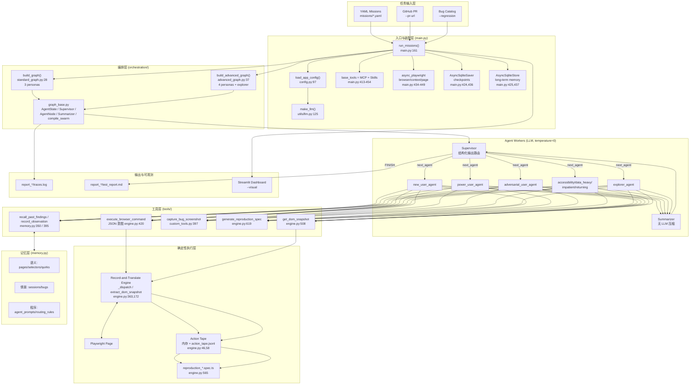
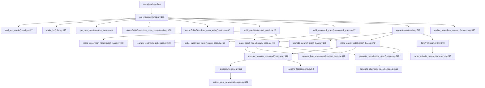
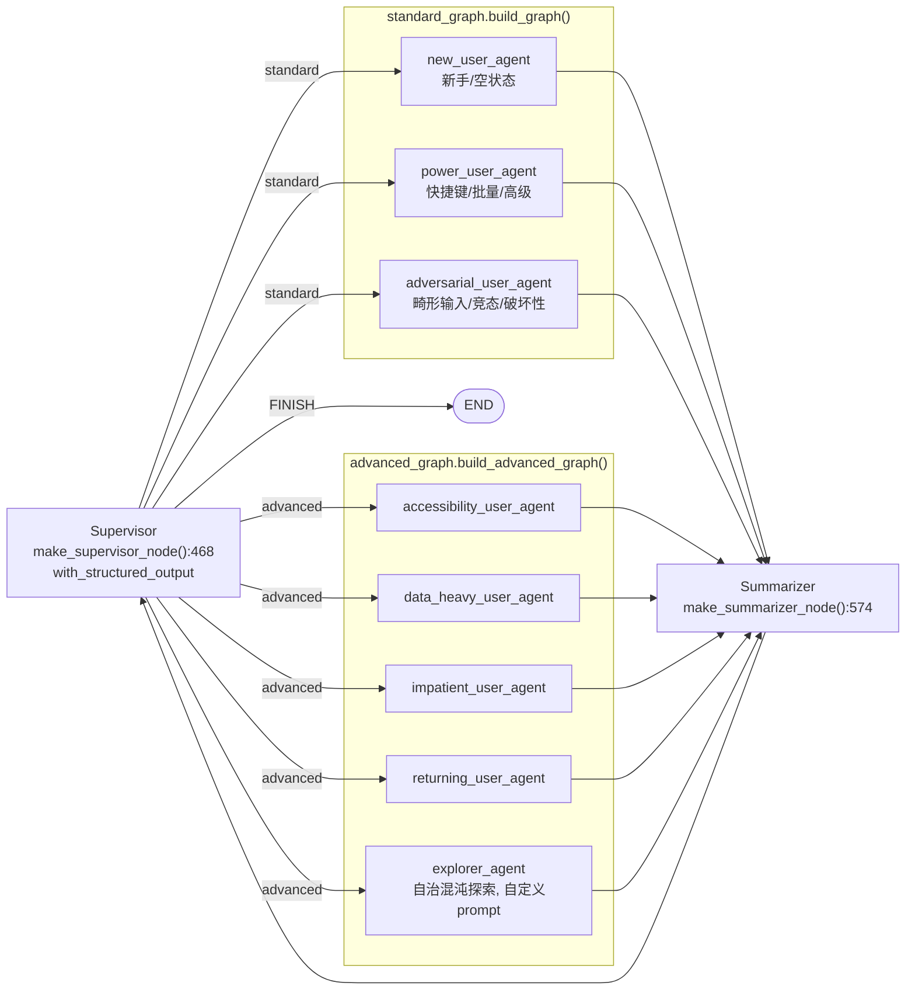
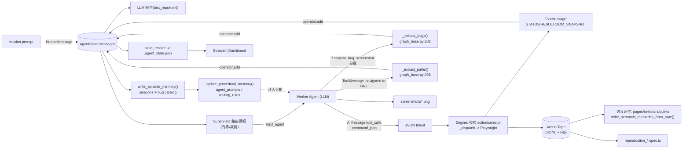
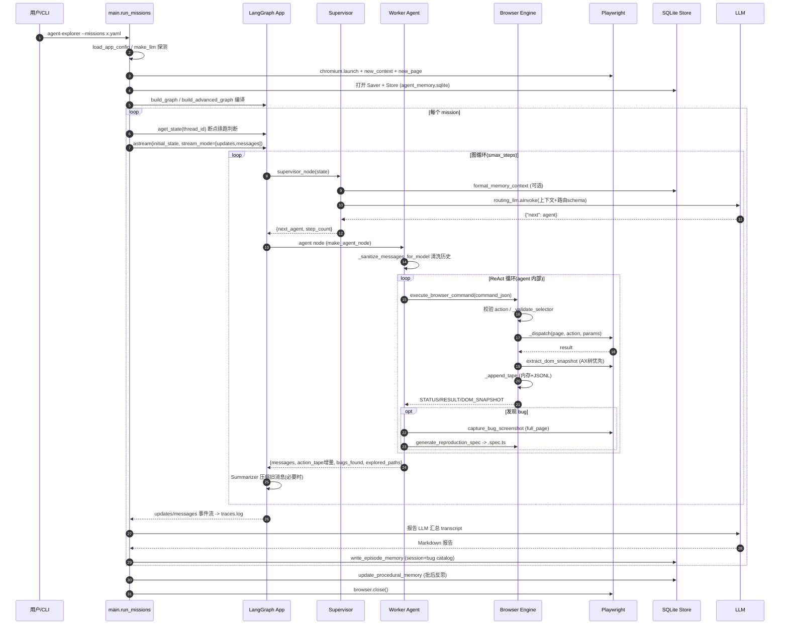
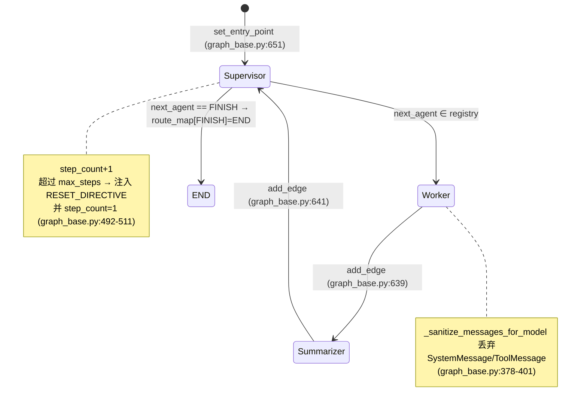
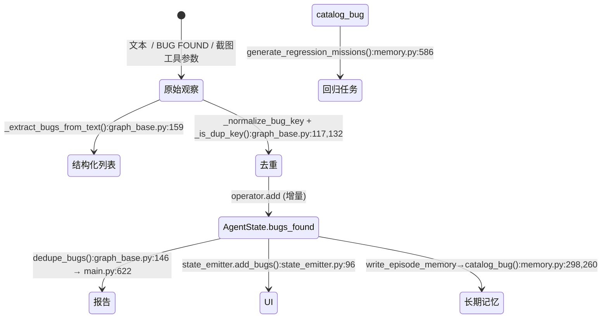

# Agentic Test Explorer（ATE）整体架构分析

> 源码基线：本地仓库 `.research-tmp/ate`，v0.2.0，最后提交 2026-10-03。
> 取证原则：本文所有类名/函数/行号均来自实际读取的源码文件。标注含义：
> - **【源码】** = 源码中确实存在，行号可核对；
> - **【文档声称】** = 仅见于 README / ARCHITECTURE_GUIDE.md，未逐字在源码验证或源码与文档有出入；
> - **【推断】** = 依据源码结构的合理推断，尚未从运行时核实。

---

## 1. 整体架构图



要点：
- **Supervisor-Worker 集中式路由，而非去中心化 Swarm**【源码】：虽然函数名为 `compile_swarm` / "swarm"，但 `graph_base.py:646-651` 只有一个 `Supervisor` 节点做条件路由，所有 worker 经 `Summarizer` 回到 `Supervisor`。【推断】命名沿用 Swarm 是历史习惯，本质是 hub-and-spoke。
- 浏览器层刻意"去工具化"：`base_tools = doc_tools + skill_tools`，**显式排除**原始 `PlaywrightBrowserToolkit` 工具（`main.py:451-454`、`graph_base.py:87-100` `filter_base_tools`）。

---

## 2. 模块职责表

| 模块 / 文件 | 职责 | 关键实现（源码定位） |
|---|---|---|
| `main.py` | CLI 解析、配置装配、Playwright/DB/Store 初始化、图编译、mission 循环、流式事件落盘、报告生成、记忆写入 | `run_missions()` `main.py:161`；图编译 `main.py:456-459`；执行 `app.astream` `main.py:517-521`；报告 `main.py:619-690` |
| `config.py` | YAML + `.env` 加载、`${ENV_VAR}` 插值、dataclass 配置对象 | `load_environment()` `config.py:29`；`_interpolate()` `config.py:45`；`AppConfig/AppMeta/AuthConfig/PathsConfig/LLMConfig` `config.py:58-94`；`load_app_config()` `config.py:97` |
| `utils/llm.py` | 多供应商 LLM 工厂与自动探测 | `make_llm()` `utils/llm.py:125`；`_detect_provider()` `:38`；`_make_gemini_llm()` `:78`；`_make_claude_llm()` `:100` |
| `utils/llm_json.py` | 从 LLM 响应抽取 JSON/YAML（含 ``` 代码块） | `extract_json_text()` `utils/llm_json.py:24`；`extract_yaml_text()` `:39` |
| `utils/console.py` | 终端彩色日志、ReAct 行渲染 | `banner/section/step/...` `utils/console.py:67-157`；`react_thought()` `:116` |
| `orchestration/graph_base.py` | 共享状态 `AgentState`、节点工厂、Supervisor、Summarizer、Bug 提取/去重、图编译 | `AgentState` `graph_base.py:70`；`make_agent_node()` `:404`；`make_supervisor_node()` `:468`；`make_summarizer_node()` `:574`；`compile_swarm()` `:630`；`dedupe_bugs()` `:146` |
| `orchestration/standard_graph.py` | 标准 3 人格 swarm 构建 | `build_graph()` `standard_graph.py:28`；persona 定义 `:70-83` |
| `orchestration/advanced_graph.py` | 高级 4 人格 + 自治 explorer 构建 | `build_advanced_graph()` `advanced_graph.py:37`；persona `:77-94`；explorer `:106-119` |
| `tools/browser/engine.py` | JSON 意图执行、DOM 快照、Action Tape、`.spec.ts` 生成 | `execute_browser_command()` `engine.py:420`；`_dispatch()` `:363`；`extract_dom_snapshot()` `:172`；`generate_playwright_spec()` `:565`；`get_code_generator_tool()` `:617` |
| `tools/common/custom_tools.py` | MCP 工具加载、Agent Skills 加载/执行、截图证据、视觉分析 | `get_mcp_tools()` `custom_tools.py:43`；`fetch_agent_skill()` `:129`；`run_agent_skill_script()` `:242`；`get_screenshot_tool()` `:395`；`get_visual_validation_tool()` `:349` |
| `pr_analyzer.py` | PR 数据抓取（MCP 优先、`gh` 回退）、LLM 生成 mission YAML、校验 | `fetch_pr_data()` `pr_analyzer.py:340`；`generate_missions_from_pr()` `:533`；`_validate_missions()` `:496` |
| `memory.py` | SQLite Store 上的 4 级记忆、Bug Catalog、回归任务生成、应用模型导出、页面风险排序 | 命名空间 `memory.py:7-15`；`app_url_hash()` `:27`；`catalog_bug()` `:260`；`write_episode_memory()` `:298`；`update_procedural_memory()` `:495`；`generate_regression_missions()` `:586`；`export_app_model()` `:626`；`prioritize_pages()` `:683` |
| `ui/state_emitter.py` | 非阻塞状态发射，原子写 `.agent_state.json` | `VisualState` `state_emitter.py:50`；`emit()` `:148`；`add_bugs()` `:96`；`schedule_screenshot()` `:165` |
| `ui/swarm_diagram.py` | 生成高亮当前节点的 Mermaid 拓扑 | `generate_swarm_diagram()` `swarm_diagram.py:29` |
| `ui/dashboard.py` | Streamlit 只读轮询面板 | `_main()` `dashboard.py:127` |

---

## 3. 核心调用关系图



---

## 4. Agent 协作图

**两套图、8 个具名 Worker**【源码：`standard_graph.py:70-83`、`advanced_graph.py:77-119`】：



协作机制要点：
1. **任务如何传递**：mission 的 prompt 作为 `HumanMessage` 进入 `AgentState.messages`（`main.py:499-506`）；Supervisor 每次读取有界路由简报（`_build_routing_context()` `graph_base.py:318`，含 MISSION/RECENT_PROGRESS/RECENT_BROWSER_ACTIONS/BUGS_FOUND/EXPLORED_URLS/MEMORY_CONTEXT），用 `with_structured_output(schema=SupervisorRouting, method="function_calling")` 输出 `{"next": <agent或FINISH>}`（`graph_base.py:480-489,543-547`）；`compile_swarm` 的 `add_conditional_edges("Supervisor", lambda state: state["next_agent"], route_map)` 完成实际跳转（`graph_base.py:643-650`）。【源码】
2. **每个 Worker 是一个 LangChain `create_agent` 实例**，共享同一组 tools，仅 system_prompt（角色 + focus）不同（`standard_graph.py:91-93`、`advanced_graph.py:102-104,119`）。【源码】
3. **步数上限重置**：`current_step = step_count+1`，超过 `max_steps`（默认 30，`main.py:172`）时由 Supervisor 注入"回到首页、换一个完全不同区域"的 `RESET_DIRECTIVE`，并把计数归 1（`graph_base.py:491-511`）。这是防循环机制，不是任务完成判定。【源码】
4. **"Swarm" 名不副实**：不存在 Agent 之间的直接 handoff / 消息互传；协作完全经 Supervisor 中转。【源码 + 推断】

---

## 5. 数据流图



关键状态字段与 reducer【源码：`graph_base.py:70-80`】：

| 字段 | 类型 / reducer | 语义 |
|---|---|---|
| `messages` | `Annotated[Sequence[BaseMessage], operator.add]` | 追加式消息历史 |
| `next_agent` | `str` | Supervisor 选定的下一个 worker（或 FINISH） |
| `action_tape` | `Annotated[List[Dict], _bounded_tape_reducer]` | 仅保留最近 **50** 条（`_ACTION_TAPE_STATE_LIMIT=50`，`graph_base.py:61,64-67`）；全量在 JSONL |

> **可信度边界（源码核实）**：`get_action_tape()`（`engine.py:49`）返回可变 `List`，`_append_tape()`（`:58-66`）以 `"a"` 追加模式写 JSONL 且写盘失败仅 `warn`；源码未发现哈希链、签名或篡改检测。源码注释中的 "immutable" 是设计意图表述，Tape 实质是**按正常执行路径追加的操作日志**，不构成安全意义上的不可变证据，也不等于 TraceGuard 的正式 Evidence。另 `get_dom_snapshot_tool()`（`:505`）明确不写 Tape，故 Tape 不是完整浏览器交互轨迹。
| `step_count` | `Annotated[int, lambda _old,new: new]` | 覆盖式计数器 |
| `bugs_found` | `Annotated[List[str], operator.add]` | **增量**追加（各节点只返回新发现） |
| `explored_paths` | `Annotated[List[str], operator.add]` | **增量**追加 |

> 【源码佐证】`main.py:537-543` 明确注释 bugs_found/explored_paths 是 per-node DELTA，需用 `add_bugs`/`add_paths` 累积，否则 UI 计数会错；对应回归测试 `test_state_emitter.py:272-305`。

---

## 6. 执行时序图



---

## 7. 关键状态流转图



Bug 数据的状态流转【源码】：



---

## 8. 架构分层小结与证据可信度

| 层次 | 设计意图（源码证据） | 证据等级 |
|---|---|---|
| 编排 | 单 Supervisor + 多 Worker + Summarizer，集中路由、步数封顶、上下文有界 | 【源码】充分（`graph_base.py` 全文件） |
| 执行 | Brain/Hands 分离：Agent 只发 JSON 意图，Playwright 确定性执行；Action Tape 全量落盘、State 内有界 | 【源码】充分（`engine.py` 全文件） |
| 复现 | Tape → `_tape_entry_to_ts` → `.spec.ts`，失败步骤保留为注释；`snapshot`/`check_page_health` 回放为 no-op | 【源码】充分（`engine.py:523-611`） |
| 记忆 | 4 级（语义/情景/程序/优先级）基于 LangGraph Store + langmem | 【源码】充分（`memory.py` 全文件）；"认知 4 级"的**理论**表述见【文档声称】`ARCHITECTURE_GUIDE.md:1064-1111` |
| 可观测 | 事件流落 traces.log + 原子写 `.agent_state.json` + Streamlit 只读轮询 | 【源码】充分 |
| 文档可信度 | **架构文档多处行号过时**：如文档称 `compile_swarm()` 在 graph_base.py:442、`make_supervisor_node()` 在 :291、`AgentState` 在 :55、`app_url_hash()` 在 memory.py:25，而源码实际分别在 `630`、`468`、`70`、`27`。文档称持久化文件为 `checkpoints.db`/`memory.db`（`ARCHITECTURE_GUIDE.md:1565-1566`），源码实际**两者共用 `agent_memory.sqlite`**（`main.py:436-437`）。文档示例 `_is_transient_error` 关键字为 "rate limit/overloaded"（`:1634-1638`），源码实际为 "503/UNAVAILABLE/429/RATE_LIMIT/..."（`main.py:151-153`）。 | **【源码 vs 文档声称冲突】以源码为准** |

---

## 9. 与 TraceGuard 的初步映射（仅标注，不做设计）

> TraceGuard 核心原则：Agent 是能力层不是事实层；Playwright 负责确定性执行；Oracle 独立于 Agent；相关不等于因果。

| ATE 组件（源码） | 可类比 TraceGuard 概念 | 初步判断 |
|---|---|---|
| `execute_browser_command` + `_dispatch`（JSON 意图/确定性执行） | Explorer Agent 的执行出口 / Playwright 确定性执行 | 方向一致：ATE 已把"决策"与"执行"分离 |
| `extract_dom_snapshot`（AX 树优先）、Action Tape | Exploration Trace / Event/Evidence | ATE 的 tape 是**动作日志**，非语义化 Evidence Graph |
| `capture_bug_screenshot`、`_extract_bugs` | Evidence / Event | ATE 的"证据"是截图 + LLM 文本抽取，缺独立校验 |
| `generate_playwright_spec`（Tape→spec.ts） | TestCase Compiler / 复现 | 方向一致，但 ATE 为**线性重放**，无语义编译与断言 Oracle |
| Supervisor / Worker | Explorer Agent / Active Diagnosis Planner | ATE 的 Supervisor 仅做路由，不做诊断规划 |
| `catalog_bug` / Bug Catalog | Diagnosis 记忆 | ATE 记录"发现文本"，未做因果诊断 |
| `format_memory_context` / `prioritize_pages` | Evidence Graph 的查询侧 | ATE 为向量/关键词检索 + 风险打分，非图结构 |
| **缺失对照** | **Trusted Oracle** | 【源码】ATE 没有独立于 Agent 的 Oracle；bug 判定来自 Agent 文本与 `check_page_health` 的启发式 JS 扫描（`engine.py:259-299`），违反"Oracle 独立于 Agent"原则 |
| **缺失对照** | **RepairProposal / UI-FaultBench** | 【源码】ATE 无修复建议生成，也无故障注入基准 |
