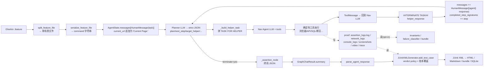
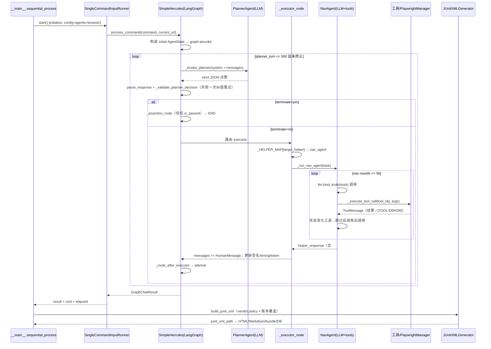
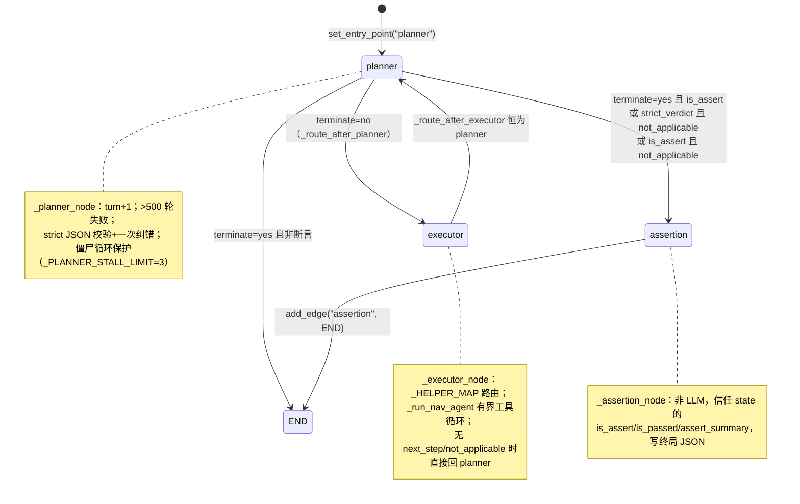

# TestZeus Hercules 整体架构分析（源码级）

> 全部类名/函数名/路径均来自实际 Read 的源码。无法从源码确认处标注「推断」或「尚未从源码核实」。
> 版本 1.0.1；许可证 AGPL-3.0（见 `项目概览.md` 第 2 节）。

---

## 1. 总体架构图（mermaid）

```mermaid
flowchart TB
    subgraph IN["输入层"]
        GF["Gherkin Feature / Steps<br/>utils/gherkin_helper.split_feature_file<br/>utils/gherkin_generator（LiteLLM 生成）"]
    end

    subgraph ORCH["编排层 orchestrator/"]
        SM["__main__.sequential_process()<br/>逐场景串行 + build_junit_xml"]
        RM["run_manager.py<br/>run_feature_isolated / run_scenarios_parallel<br/>子进程隔离 + 私有 workspace"]
        SU["suites.py<br/>run_suite（YAML suite + depends_on + retry）"]
        SCH["scheduler.py<br/>run_monitor_once（回归检测 + webhook）"]
        SE["session.py<br/>SessionState（MCP 会话持久化）"]
    end

    subgraph RUN["执行入口 core/"]
        RUNNER["runner.py<br/>BaseRunner / SingleCommandInputRunner<br/>process_command()"]
        SH["simple_hercules.py<br/>SimpleHercules（LangGraph StateGraph）<br/>_planner_node / _executor_node / _assertion_node"]
    end

    subgraph AGENTS["Agent 层 core/agents/"]
        PL["PlannerAgent<br/>high_level_planner_agent.py"]
        BNAV["BrowserNavAgent（多模态）<br/>browser_nav_agent.py"]
        ANAV["ApiNavAgent / SqlNavAgent / McpNavAgent<br/>ExecutorNavAgent / SecNavAgent / TimeKeeperNavAgent"]
        BASE["BaseNavAgent / MultimodalBaseNavAgent<br/>bind_tools + 工具循环由 SimpleHercules 驱动"]
    end

    subgraph TOOLS["能力层 core/tools/ + extra_tools/"]
        TR["tool_registry.py（@tool 注册）<br/>langchain_tools.registry_tools_to_structured_tools"]
        BTOOLS["open_url / click / get_interactive_elements / ...<br/>ui_assertions.assert_ui / api_assertions.assert_json_path"]
        PW["playwright_manager.py<br/>PlaywrightManager（stake_id 单例）<br/>get_current_page / async_initialize"]
    end

    subgraph MEM["记忆/配置 core/memory/ + config"]
        STH["state_handler.py<br/>_state_string / _state_dict（进程全局）<br/>store_data / store_run_data"]
        CFG["AgentsLLMConfig / AgentRegistry<br/>agents_llm_config.py / agent_registry.py"]
        LTM["static_ltm.get_user_ltm"]
    end

    subgraph HEAL["自愈 healing/（旁路 opt-in）"]
        FC["failure_classifier.classify_failure<br/>正则启发式"]
        HP["heal_proposer.HealProposal<br/>propose_from_store / alternatives / llm"]
        SS["selector_store.SelectorStore<br/>JSON 持久化"]
    end

    subgraph REPORT["报告 reporting/ + utils/"]
        JH["junit_helper.JUnitXMLGenerator<br/>verdict policy + 断言账本覆盖"]
        MD["markdown_report.generate_markdown_report"]
        BD["bundle.create_failure_bundles"]
        DB["run_db.RunHistory（SQLite/SQLAlchemy）"]
        HTML["junit2htmlreport.run（第三方）"]
    end

    GF --> SM
    GF --> RM
    SU --> RM
    SCH --> SU
    SM --> RUNNER
    RM -.子进程 python -m testzeus_hercules.→ RUNNER
    RUNNER --> SH
    SH --> PL
    SH --> BNAV
    SH --> ANAV
    PL -.strict JSON 决策.-> SH
    BNAV --> BASE
    ANAV --> BASE
    BASE --> TR
    TR --> BTOOLS
    BTOOLS --> PW
    BTOOLS --> STH
    CFG --> PL
    CFG --> BASE
    LTM --> PL
    LTM --> BASE
    SH --> JH
    JH --> MD
    JH --> BD
    JH --> DB
    JH --> HTML
    HEAL -.分类/提案，未接入主图.-> BD
    HEAL -.未接入主图.-> DB
```

---

## 2. 分层职责表

| 层 | 目录/文件 | 职责（源码依据） |
|---|---|---|
| 入口 | `testzeus_hercules/__main__.py` | `sequential_process()`：逐场景跑 runner、构建 junit、可选报告/历史/分类；`a_main()`/`main()`；`compute_exit_code` |
| 编排 | `orchestrator/run_manager.py` | 子进程隔离执行（`run_feature_isolated`）、并行（`run_scenarios_parallel`）、junit 合并；"in-process parallelism is unsafe (global config singleton + PlaywrightManager singletons)"（文件头注释） |
| 编排 | `orchestrator/suites.py` | YAML suite：`load_suites`/`resolve_suite`/`run_suite`，`depends_on` 门控、`retry`、`max_parallel`、`shared_state` |
| 编排 | `orchestrator/scheduler.py` | 监控守护 `monitor_loop`/`run_monitor_once`，`evaluate_regression` 对比 base，webhook 通知 |
| 编排 | `orchestrator/session.py` | MCP 会话 `SessionState`（app_url 凭据脱敏、`plan_approved_sha256` 计划批准哈希） |
| Runner | `core/runner.py` | `BaseRunner.initialize/process_command/clean_up/shutdown`；`SingleCommandInputRunner.start` |
| 状态机 | `core/simple_hercules.py` | `SimpleHercules`：LangGraph `StateGraph(AgentState)`；`_planner_node`/`_executor_node`/`_assertion_node` + 路由 + `_run_nav_agent` 工具循环 |
| Planner | `core/agents/high_level_planner_agent.py` | `PlannerAgent`：构造 system prompt（`"# Test Execution Task Planner"`）+ LLM；输出 strict JSON |
| 导航 Agent | `core/agents/*_nav_agent.py` | 各领域 Agent：仅声明 `prompt`、`register_tools()`；实际工具循环由 `SimpleHercules._run_nav_agent` 统一驱动（见第 4 节） |
| 工具注册 | `core/tools/tool_registry.py` | 全局 `tool_registry`（按 agent_name 分组），`@tool(agent_names, description, name)` 装饰器；`assertion_logger`/`assertion_subject` 审计账本 |
| 工具转换 | `utils/langchain_tools.py` | `registry_tools_to_structured_tools`（README.md:881-883 亦声称） |
| 浏览器 | `core/playwright_manager.py` | `PlaywrightManager`：stake_id 单例、浏览器上下文、截图/视频/trace、页面与导航等待、request/console 日志、元素查找/点击辅助 |
| 状态记忆 | `core/memory/state_handler.py` | 进程全局 `_state_string`/`_state_dict`，`store_data`/`store_run_data` 工具，`clear_runtime_state` |
| 配置 | `core/agents_llm_config.py`、`agent_registry.py`、`agent_config_types.py` | provider→agent 配置归一化与注册；`ModelAPIType=Literal["litellm"]` |
| 自愈 | `healing/*.py` | 失败启发式分类、selector 提案与持久化探测（旁路模块） |
| 报告 | `reporting/*.py`、`utils/junit_helper.py` | JUnit XML 生成与 verdict 策略、断言账本覆盖、Markdown 报告、证据 bundle、SQLite 历史 |
| 约束/不变量 | `core/invariants.py`、`core/post_process_responses.py` | observer 不变量（BINDING/NOTICE）；`final_reply_callback_planner_agent` 记录 STEP 事件 |

---

## 3. 核心调用关系（关键函数级）

```
__main__.main() → a_main() → sequential_process()
  → process_feature_file()（拆场景）
  → for feat: SingleCommandInputRunner(stake_id, command).start()
       → BaseRunner.initialize()
            → AgentsLLMConfigManager.get_instance().initialize()
            → SimpleHercules.create(stake_id, planner_cfg, nav_cfg, helper_cfg, ...)
                 → _initialize_agents()：创建 PlannerAgent + 7~9 个 nav agent + helper_agent(image-comparer)
                 → _build_graph()：StateGraph(AgentState) 编译
            → PlaywrightManager(gui_input_mode=False, stake_id).async_initialize()
       → BaseRunner.process_command(cmd)
            → SimpleHercules.process_command(command, current_url)
                 → 构造 initial AgentState → self._graph.ainvoke(initial, config{recursion_limit:2000})
                 → [planner] → _planner_node() → PlannerAgent.llm（strict JSON）→ parse_response → _validate_planner_decision（一次纠错重试）
                 → 路由 _route_after_planner() → executor / assertion / end
                 → [executor] → _executor_node() → _build_helper_task() → _run_nav_agent(nav_agent, task, name)
                      → llm.bind_tools(tools) → 循环 nav_agent_number_of_rounds 次：
                           LLM → tool_calls → _execute_tool_call(tool_obj, name, args) → ToolMessage → 回到 LLM
                           → 遇 "##TERMINATE TASK##" 退出；状态变化工具触发状态刷新、跳过陈旧 tool_calls
                 → 路由 _route_after_executor() → 始终 "planner"
                 → [assertion] → _assertion_node()：信任 state 的 is_assert/is_passed/assert_summary，写终局 JSON，结束
                 → 若有 BINDING 不变量 → _apply_invariant_failure() 强制判红
                 → 组装 GraphChatResult（chat_history/messages/cost/terminate/last_helper_response）
  → build_junit_xml() → JUnitXMLGenerator.add_test_case()（verdict policy + 账本覆盖）
  → merge_junit_xml → prepare_html（junit2htmlreport）
  → [opt-in] generate_markdown_report / create_failure_bundles / RunHistory.record_run_summary / classify_failure
```

---

## 4. Agent 组织与协作（重点：谁才是"执行者"）

### 4.1 Agent 一览（源码确证，`core/simple_hercules.py:191-227`）

| agent_name | 类 | 来源文件 | 角色 |
|---|---|---|---|
| `planner_agent` | `PlannerAgent` | `high_level_planner_agent.py` | 唯一"大脑"：产出 plan / next_step / target_helper / terminate / 断言字段 |
| `browser_nav_agent` | `BrowserNavAgent` | `browser_nav_agent.py`（继承 `MultimodalBaseNavAgent`） | 浏览器导航，使用 md 属性定位 |
| `api_nav_agent` | `ApiNavAgent` | `api_nav_agent.py` | API 调用与响应断言 |
| `sec_nav_agent` | `SecNavAgent` | `sec_nav_agent.py` | 安全测试（README 称集成 Nuclei） |
| `sql_nav_agent` | `SqlNavAgent` | `sql_nav_agent.py` | 数据库操作 |
| `time_keeper_nav_agent` | `TimeKeeperNavAgent` | `time_keeper_nav_agent.py` | 时间/等待 |
| `mcp_nav_agent` | `McpNavAgent` | `mcp_nav_agent.py` | MCP 工具发现与调用（`ensure_tools_ready`） |
| `executor_nav_agent` | `ExecutorNavAgent` | `executor_nav_agent.py` | Python 沙箱脚本执行 |
| `helper_agent` | `create_multimodal_agent(name="image-comparer", ...)` | `llm_helper.create_multimodal_agent` | 视觉比较（非导航 Agent） |
| `mobile_nav_agent` | `MobileNavAgent` | `mobile_nav_agent.py`（条件创建） | Appium 移动端，双门控 |

### 4.2 协作机制

1. **Planner 与 helper 是"大脑—原始执行者"关系**（`high_level_planner_agent.py:131-145` 的 prompt 明确："Helpers are PRIMITIVE agents... NO KNOWLEDGE of overall test context or plan"，Planner 只给 WHAT 不给 HOW）。
2. **执行循环并不在各 Agent 类里**。`*_nav_agent.py` 文件几乎只有 `prompt` 字符串与 `register_tools()`（`self.load_tools()`）；真正的多轮 tool-calling 循环在 `SimpleHercules._run_nav_agent`（`core/simple_hercules.py:1243-1380`）——`llm.bind_tools(tools)`、`for _turn in range(nav_agent_number_of_rounds)`、`##TERMINATE TASK##` 退出、max rounds 返回 `[ERROR] ... max nav rounds ...`。**这是理解本项目的关键反直觉点。**
3. **路由表**：`_HELPER_MAP`（`:796-806`）把 `target_helper` 字符串映射到 agent_name；`agent` 也映射到 `browser_nav_agent`，`Not_Applicable` 不映射。若请求的 agent 未创建则回退 browser（`:1158-1164`）。
4. **工具可见性由注册表控制**：`tool_registry` 按 agent_name 分组；`BaseNavAgent.register_tools()` 调 `registry_tools_to_structured_tools(self.agent_name)`；`ExecutorNavAgent.register_tools()`/`ApiNavAgent.register_tools()` 调 `self.load_tools()` 动态加载 `ADDITIONAL_TOOL_DIRS`（`base_nav_agent.py:84-123`）。

### 4.3 "独立 Assertion Agent" 问题（如实结论）

**源码中未发现独立的 Assertion Agent 角色。** 实际做法：

- LangGraph 里确实有一个 `assertion` 节点（`_build_graph` `core/simple_hercules.py:1446-1463`，`graph.add_node("assertion", self._assertion_node)`），但它**不是 Agent**：`_assertion_node`（`:1386-1423`）不调用任何 LLM，而是读取 `state["is_passed"]`/`state["assert_summary"]`/`state["final_response"]`，拼出终局 JSON 并写入 `messages`，打一条 `step_timings` 的 `"node": "assertion"` 记录。其注释直书 "Assertion node — trusts planner's is_assert/is_passed/assert_summary"。
- 路由 `_route_after_planner`（`:1425-1440`）：终止且 `is_assert` 为真（或 strict verdict 且 `not_applicable`）→ `assertion`；否则 `end`；未终止且 `is_assert and target_helper == "not_applicable"` → `assertion`；其余 → `executor`。`_route_after_executor` 永远返回 `"planner"`（`:1442-1444`）。
- **确定性断言是工具而非 Agent**：`core/tools/ui_assertions.py` 的 `assert_ui`（`:320-338`）与 `capture_ui_value`（`:482-497`）；`core/tools/api_assertions.py` 的 `assert_json_path`（`:316-332`）。两者都返回 minified JSON `{"assertion": "PASSED|FAILED|ERROR", ...}` 并写入 `assertion_logger` 账本。
- verdict 的最终落点在 `utils/junit_helper.py:366-401`：`is_passed`/`is_assert`/`terminate` 决定 JUnit Failure；若账本有 `FAILED`/`ERROR` 且场景自称 pass，则覆盖为 Failure（`_ledger_override_message`）。
- **结论**：断言判定由 **Planner 自报 verdict → 可选确定性工具（默认 UI 断言关闭）→ 报告期断言账本覆盖 + strict verdict + observer 不变量** 共同完成，**不存在独立 Assertion Agent**。

---

## 5. 数据流图（mermaid）



**关键状态字段**（`core/simple_hercules.py:57-90` `AgentState(TypedDict)`）：`messages`、`task`、`plan`、`next_step`、`target_helper`、`terminate`、`final_response`、`is_assert`、`assert_summary`、`is_passed`、`planner_turn`、`progress_stall_count`、`step_token_log`、`total_prompt_tokens`、`total_completion_tokens`、`total_cost`、`cost_available`、`step_timings`、`completed_step_signatures`、`last_helper_response`、`current_url`。

---

## 6. 执行时序图（mermaid，单个场景）



---

## 7. 状态流转图（mermaid，StateGraph）



补充：`process_command` 在图结束后，若 `_invariant_binding` 非空，会调用 `_apply_invariant_failure()` 把 `is_passed=False`、`is_assert=True` 强制写入 final_state 并改写最后一条 assistant 消息（`core/simple_hercules.py:1606-1610,1070-1115`）——这是**图外**的判红旁路。

---

## 8. 工具失败与边界处理（源码确证）

| 场景 | 处理机制 | 来源 |
|---|---|---|
| 工具不存在 | `tool_result = "[ERROR] Tool '<name>' not found."` | `simple_hercules.py:1339-1342` |
| 工具抛异常 | `_execute_tool_call` 捕获 → `"[TOOL ERROR] <name>: <e>"` | `simple_hercules.py:933-967` |
| 工具参数非法 | `"__invalid_tool_args__"` 检测 → `[TOOL ERROR]` | `simple_hercules.py:934-935` |
| 工具输出过大 | `_truncate_tool_result` 截断到 `_MAX_TOOL_RESULT_CHARS=20000` | `simple_hercules.py:100-102,926-931` |
| 浏览器状态被工具改变 | `_BROWSER_STATE_CHANGING_TOOLS` + `_STATE_REFRESH_MARKERS` → 跳过同批剩余 tool_calls 并提示重读 | `simple_hercules.py:808-830,1348-1370` |
| Nav LLM 上下文超限 | `_is_context_limit_error` → `_compress_messages` 后重试 | `simple_hercules.py:339-386,1302-1316` |
| Nav 达最大轮数 | 返回 `[ERROR] <agent> max nav rounds (N) reached before ##TERMINATE TASK##` | `simple_hercules.py:1372-1380` |
| Planner 决策 schema 错 | `_validate_planner_decision` → `_corrective_planner_prompt` 纠错一次 → 仍错则 `_planner_failure_result` 判红 | `simple_hercules.py:467-516,620-662` |
| Planner LLM 超时/异常 | `_planner_timeout_result` / `_planner_failure_result` → 终局失败 JSON，场景记为 failed | `simple_hercules.py:394-461,528-543` |
| 场景整体崩溃 | `process_command` 捕获 → `_failed_graph_result` 写终局失败 JSON + 脱敏证据 | `simple_hercules.py:1648-1664,1510-1548` |
| 清理失败 | `BaseRunner.clean_up` 聚合 `BaseExceptionGroup`，cancellation 优先 | `runner.py:90-114` |
| 并发不安全 | 用子进程隔离（全局 config/Playwright 单例不可并发） | `run_manager.py:1-9` |

---

## 9. 优点 / 缺陷 / 局限（含安全边界、证据可信度）

### 优点（源码确证）
- **防御性编码充分**：关键路径都有 containment（工具错误、LLM 错误、清理错误、子进程超时杀进程组、junit 生成失败兜底），大量 `BaseExceptionGroup`/`CancelledError` 处理（runner、playwright_manager、run_manager）。
- **证据与反作弊设计**：断言账本 `assertion_logs.log`（连 PASSED 都记录，`tool_registry.py:131-145`）、`assertion_subject` sha1 指纹去重（`tool_registry.py:148-159`）、junit verdict 覆盖（`junit_helper.py:391-401`）、`Assertions Missing` 标记（`:431-434`）、observer 不变量（5xx/uncaught 异常判 BINDING）。
- **确定性断言工具设计优良**：`assert_ui` 对空负载返回 ERROR、`absent` 要求 `must_contain` 正对照、去 URL/id/class 噪声、placeholder 启发式（有明确 tradeoff 文档 `ui_assertions.py:1-52`）；`assert_json_path` 严格类型相等 + 文本回退有 note、多匹配需全部满足、未解析占位符直接 ERROR。
- **可观测性**：thorough token/cost/timing 记录、video/screenshot/trace/network/console 全留痕、SQLite 历史与趋势。
- **隔离与编排**：子进程 + 私有 workspace（成功清理、失败保留）、suite 依赖门控、监控回归 + webhook（含 webhook URL/文本脱敏 `scheduler.py:46,390-392`）。

### 缺陷 / 局限
1. **AGPL-3.0 强 copyleft**：第 13 条仅针对修改版网络交互（非所有 SaaS 使用）；商用/集成需法务评估（见 `项目概览.md` 第 2 节）。
2. **Playwright 锁定 `<=1.49.0`**（`pyproject.toml:24`）：版本陈旧，升级需人工验证，存在兼容/安全债。
3. **复杂度高**：30+ 模块、singleton + 进程全局状态（state_handler、config、PlaywrightManager）+ 子进程 + 多 opt-in 开关，学习与维护成本高；README 也提示架构已迁移（docs/Migration/）。
4. **verdict 事实层不独立（精确表述）**：核心 verdict 由 LLM Planner 自报（`is_passed`）。确定性断言工具并非全部 opt-in：`assert_json_path` 注册给 `api_nav_agent` 默认可用（`api_nav_agent.py:60-61`、`api_assertions.py:303-328`），`assert_ui` 受 `ENABLE_UI_ASSERTIONS` 控制默认关闭（`ui_assertions.py:14,596-609`、`config.py:837,1274-1275`）；两者被调用时都会写审计账本（`api_assertions.py:267-289`、`ui_assertions.py:270-290`、`tool_registry.py:133`）。报告侧 `junit_helper.py` 读取账本：账本含 FAILED/ERROR 而 Planner 声称 pass 时**会覆盖为失败**（`:31-45,368-387`）；但**零断言的 pass 仅被标记 `Assertions Missing`，不自动判红**——把该标记收紧为失败是独立的显式迁移步骤。此外 `STRICT_VERDICT` 默认关闭（`env_flags.py:6,61-63`），无显式断言的场景默认允许 Planner 声称通过。因此正确结论是：**Hercules 具备确定性 API 断言工具、UI 断言需显式启用，账本可拦截部分虚假通过，但最终 verdict 仍依赖 Planner 状态声明，且缺少 TraceGuard 要求的、经可信来源绑定与人工审核的独立 Trusted Oracle**——不能简化为"完全靠 LLM 自报"，也不能把"有确定性断言工具"等同于"有独立可信 Oracle"。
5. **启发式 ≠ 因果**：`healing/failure_classifier.py` 用正则信号 + 命中占比作为 confidence（`:80-132,167-187`），明确是 heuristic；与 TraceGuard "相关不等于因果"直接冲突。
6. **安全边界**：
   - `ExecutorNavAgent` 的 `execute_python_sandbox` 把 `page/browser/context/playwright_manager/logger/config` 注入脚本（`executor_nav_agent.py:19,91-95`），"沙箱"边界需单独评估；
   - heal 的 LLM prompt 只做控制字符清洗 + `<page_text>` 标记包裹不可信内容（`heal_proposer.py:40-66`），属提示层防御、非硬隔离；
   - API/SQL 工具接收 LLM 生成的路径/查询，靠工具侧校验（`api_assertions.py` 的 `__invalid_tool_args__`、JSONPath 合法性校验等），未发现统一沙箱层。
7. **证据可信度依赖配置**：`ENABLE_UI_ASSERTIONS`、`ENABLE_OBSERVER_INVARIANTS`、`ENABLE_FAILURE_CLASSIFICATION`、`ENABLE_RUN_HISTORY`、`ENABLE_FAILURE_BUNDLES`、`ENABLE_RUN_REPORTING` 多为默认关（`env_flags.py:30-70`、`ui_assertions.py:14`）。**修正此前"默认没有断言工具写账本、账本近乎空转"的说法**：默认安装下 `assert_json_path`（API 确定性断言）已注册且会写账本，账本覆盖机制并非空转；真正的关键局限是——账本覆盖只在**有断言工具实际被调用**时才有内容，而零断言场景默认仅标记 `Assertions Missing` 不判红，且 UI 断言与 strict verdict 需显式开启，因此默认配置下的判定强度仍显著低于 TraceGuard 的独立 Oracle。
8. **回归检测键不稳定**：scheduler 自述 `max_parallel` 变化会改变 scenario key，导致基线漏报（`scheduler.py:276-279`）。

### 与 TraceGuard 原则的架构差距
| 原则 | Hercules 现状 |
|---|---|
| Agent 是能力层不是事实层 | 部分满足：有确定性工具，但 verdict 主体仍由 Planner 自报 |
| Playwright 负责确定性执行 | 满足：`PlaywrightManager` 单例 + 工具封装 |
| Oracle 独立于 Agent | **不满足**：无独立 Assertion Agent/Oracle（见第 4.3 节） |
| 相关不等于因果 | 不满足：失败分类/置信度是启发式相关信号 |
| 修复不得削弱断言 | 基本满足：自愈仅改 selector，不触碰断言；但自愈未接入主流程， protection 不成立 |

---

## 10. 推断 / 未从源码核实项

- `SecNavAgent` 与 Nuclei 的集成细节、报告生成：**尚未从源码核实**（本次只确认 `sec_nav_agent.py` 存在并由 `_initialize_agents` 创建；README.md:929 声称集成 Nuclei，但具体调用未在本次阅读的源码中确认）。
- `helper_agent`（image-comparer）如何被 Planner 通过 `target_helper: "agent"` 调用并产生视觉比较结果：**推断**为由 `browser_nav_agent` 路由 + 单独 LLM 比较，具体拼接链路尚未从源码核实。
- `mobile_nav_agent` 的实际工具集与 Appium 会话细节：**尚未从源码核实**（仅确认双门控创建逻辑）。
- "v1.0.1 最后提交 2026-10-24"来自任务书，未在 git log 中二次核对。
